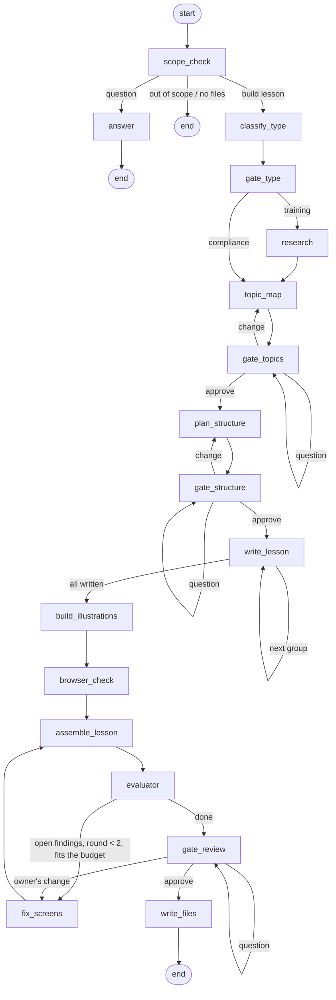

# Lomda Builder Agent

A command-line agent that turns a content owner's source material (PowerPoint, Word, PDF,
text, Markdown) into a Hebrew interactive e-learning lesson ("lomda") that opens in any
browser, offline. A human approves every major stage. Built with LangGraph; every model call
goes through OpenRouter.

The agent talks to its user in Hebrew; code, docs and prompts are in English. The full
design and the decisions behind it are in [docs/SPEC.md](docs/SPEC.md) (Hebrew).

## What it does

1. **Read**: `/add <file>` reads a source file through a local MCP server (`source-reader`)
   and scans it for prompt injection (`injection_guard`).
2. **Scope**: every message goes through `scope_check`: questions about the material are
   answered with RAG (BM25 with Hebrew-aware tokens, cited sources); requests to build a
   lesson start the lesson flow; anything else is politely refused.
3. **Plan**: lesson type (training or compliance, gate), web research (training only),
   topic map with learning objectives (gate 1), screen structure with a decision question per
   screen and two visual-motif candidates to choose from (gate 2).
4. **Write and review**: screens are written 3-4 at a time; checkers (code and model)
   look for ungrounded facts, Hebrew errors, questions with more than one right answer,
   recall questions, weak distractors, repeated facts, weak illustrations, decision diagrams
   (both ways against the source) and the logic of every interactive illustration (its
   thresholds, numbers, choices and feedback against the source);
   only the screens with findings are rewritten (at most 2 rounds), and each finding is
   checked again by the checker that found it. Coverage is measured against the source's key
   points.
5. **Approve and save**: gate 3 shows a summary and opens a browser preview; `[Y/N]` before
   writing `output/<name>/` with `index.html`, `lesson.js`, `lesson.json`, assets and a
   `report.md` for the content owner (coverage, open findings, sources, cost).

The player never shows the right answer after a wrong one; a learner who fails sees only
which questions were wrong and retries with alternate questions; a passing learner can
download a certificate made in the browser.

## The graph



`injection_guard` runs at `/add`, outside the graph. Every gate pauses the graph with
`interrupt()`; the state is saved in `data/checkpoints.sqlite` after every node, so `/resume`
continues a conversation that stopped at a gate, at the cost cap, or in the middle of a node
(Ctrl+C, a closed window). The CLI prints `[INFO] Entering Node: <name>` for every node.

**Spending cap.** The paid nodes (research, topic_map, plan_structure, write_lesson,
build_illustrations, evaluator, fix_screens) are wrapped by a cost check: before one starts, if
the run's cost so far plus the node's estimate would cross `MAX_COST_USD` (default 1.5), the
agent asks `[Y/N]` and shows the cost so far and an estimate for the rest. `Y` raises the cap
for this run; `N` finishes in order (no more fix rounds or paid checks, the lesson is kept and
saved after gate 3, and `report.md` says the run stopped at the cap) or, before the lesson is
written, pauses the run for `/resume`. While nodes run, Windows is kept awake.

## Extensions

| Extension | Status |
| --- | --- |
| **MCP**: `source-reader` server (stdio, FastMCP) for pptx, docx, pdf, txt, md; `/mcp`, `/mcp auth` | built |
| **RAG**: BM25 over the source chunks, Hebrew prefixes and niqqud handled, answers cite slide/page | built |
| **Web search**: training lessons only; OpenRouter's web plugin (Exa, 3 results, at most 12 searches a lesson); every fact needs a quote that the agent finds on the downloaded page (HTML, PDF, or the page rendered in Edge); official sources only (`agent/assets/web_sources.json`); unverified facts go to the owner at gate 2 | built |
| **Code execution**: one writer call per interactive illustration builds a self-contained HTML page, cleaned in code (no network, no eval), then, after `[Y/N]`, checked in the installed Edge at 390 and 1280 px (loads, no console errors, no sideways scroll, Tab reaches every control, using the controls changes the text the learner reads, read after animations end, no state shown as a pressed button); the player runs it in `<iframe sandbox="allow-scripts">`. A model check then compares the page's logic with the source, and a finding rebuilds the page | built |

## Install and run

### From source (Windows, Python 3.12)

```powershell
git clone https://github.com/Rinat-B/lomda-agent.git
cd lomda-agent
python -m venv .venv
.venv\Scripts\python -m pip install -r requirements.txt
copy .env.example .env        # then put your OpenRouter key in .env
.venv\Scripts\python -m agent.cli
```

### From the exe

Download `agent.zip` from the [latest release](https://github.com/Rinat-B/lomda-agent/releases/latest)
(direct link: `releases/latest/download/agent.zip`) and extract it. It holds `agent.exe`,
`.env.example` and [QUICKSTART.txt](QUICKSTART.txt) (Hebrew and English): how to get past the
Edge download warning ("Keep anyway") and Windows SmartScreen ("More info" -> "Run anyway"),
where the key goes, and the free-profile limits. Copy `.env.example` to `.env` next to the exe
(or let it ask for the key in a hidden prompt) and run it in a terminal. `agent.exe` alone is
attached to the Release too. `data/`, `logs/` and `output/` are created next to the exe. Build it yourself
with `powershell -ExecutionPolicy Bypass -File scripts\build.ps1`.

### Example

```text
> /add C:\docs\short_winter.pptx
> build me a lesson from the presentation      (in Hebrew)
[INFO] Entering Node: scope_check
[INFO] Entering Node: classify_type
...
```

## CLI commands

| Command | What it does |
| --- | --- |
| `help` / `?` | short guide: what the agent does, the commands, an example |
| `/add <path>` | add a source file (a path inside a message is detected too) |
| `/files` | the files in this conversation |
| `/mcp`, `/mcp auth <name>` | the MCP servers and their tools; enter credentials in a hidden prompt |
| `/cost` | calls, tokens and cost so far, by node and model (also printed after every task) |
| `/summary [path]` | save a summary of the conversation (files, requests and outcomes, cost) to a text file, after `[Y/N]` |
| `/resume` | continue a conversation that stopped at a gate, at the cost cap, or inside a node |
| `/new`, `/quit` | new conversation, exit |
| `agent.exe --check-browser` | check that the illustration browser test can run on this machine (installed Edge) |

At a gate: `Y` approves, `N` + comment asks for a change, free text is classified by a small
model (approve / change / question), `exit` pauses at the gate.

## Profiles and keys

| Setting (`.env`) | Required | Meaning |
| --- | --- | --- |
| `OPENROUTER_API_KEY` | yes | every model call goes through OpenRouter |
| `PROFILE` | no | `free` (default) or `balanced` (paid models); see `agent/models.yaml` |
| `LANGSMITH_API_KEY`, `LANGSMITH_TRACING`, `LANGSMITH_PROJECT` | no | tracing; without a key the agent runs and says tracing is off |
| `HEBREW_BIDI` | no | Hebrew order in the terminal: `auto` (default), `on`, `off` |
| `MAX_COST_USD` | no | the spending cap of one run in USD (default 1.5, `max_cost_usd` in `agent/models.yaml`); crossing it asks `[Y/N]` |

Each role (`writer`, `checker`, `small`) has 2-3 fallback models per profile. A 429 or error
moves to the next model; a 503 or timeout skips the model for the session; a 402 in
`balanced` switches the session to `free`. Checkers prefer a model family other than the
writer's.

**Free-model limits.** OpenRouter allows 50 free-model requests a day on an account without
credit, and 1000 a day after a one-time $10 credit purchase. A short lesson (5 slides, 5-8
screens) takes about 40-60 model calls and 40-60 minutes on the free models (with web research,
the motif, 2-3 illustrations and their logic check), so without credit you can build about one
lesson a day. Web searches cost
money even with free models (about $0.007 each). Free models also hit rate limits (429) at busy
hours; the agent waits and falls back, and a check that could not run is reported, never
counted as passed.

## Evals

Three evals plus an acceptance test for the checkers, all in [evals/](evals/); results and how
to run them: [evals/results/README.md](evals/results/README.md).

- `compare_models.py`: the same lesson by different writer models, scored by one fixed judge
  ([rubric](evals/rubric.md)), plus a one-prompt baseline without the agent
- `cost_eval.py`: cost per task, actual and theoretical (free models priced at the paid
  equivalent)
- `scope_eval.py`: out-of-scope refusals, false refusals and hidden injections
- `tests/test_checkers_acceptance.py` (`pytest -m slow`): the checkers on lessons with known
  problems

`evals/run_agent.py` runs the whole graph without a keyboard (scripted gate answers), which
all the agent evals use.

## Tests

```powershell
.venv\Scripts\python -m pytest -q          # unit tests, no model calls (~30 s)
.venv\Scripts\python -m pytest -m slow     # real models: checker acceptance
```

`tests/test_player_browser.py` drives the player in the installed Edge with Playwright and is
skipped when Edge is missing.

## Repository layout

```text
agent/
  cli.py, commands.py, gates.py, console.py   CLI, commands, gate prompts, Hebrew display
  graph.py, nodes.py                           LangGraph workflow and nodes
  writer.py, structure.py, topics.py           writing, structure and topic-map prompts/parsing
  checkers.py, evaluation.py, report.py        checkers, review loop, report.md
  illustration_logic.py, diagram_check.py      illustration logic and diagram-vs-source checkers
  research.py, illustrations.py                web research; illustrations, cleaner, browser check
  motif.py, svg_clean.py                       motif candidates from Lucide icons; SVG cleaner
  cost_cap.py, keep_awake.py, summary.py       MAX_COST_USD gate; no sleep while running; /summary
  llm.py, models.yaml, errors.py               OpenRouter calls, models per role/profile, errors
  guards.py, tools.py, mcp_client.py           injection guard, RAG, MCP client
  mcp_servers/source_reader.py                 the MCP server
  lesson_schema.py, lesson_export.py           lesson.json schema and export
  assets/                                      lesson.schema.json, player/, Hebrew messages, lucide/ (icons, ISC)
evals/                                         eval scripts, rubric, fixtures, results/
tests/                                         unit tests (pytest)
examples/sample_lesson/                        a small hand-made lesson for the player
docs/SPEC.md                                   the specification (Hebrew)
scripts/build.ps1                              PyInstaller build of agent.exe
manifest.json                                  project manifest
.github/workflows/release.yml                  builds agent.exe for a v* tag; attaches it and agent.zip to the Release
QUICKSTART.txt                                 download, first run, key and limits (Hebrew and English)
```

## Not built yet

- `/model` command; optional narration; the desktop app (bonus track)
